# Batch 0.0 · Onboarding (lesson)

No code in this batch. At the end you can explain PetrIA in two minutes and
answer the five gate questions.

Evidence labels: **verified** = read in the real files (see
[data-sources.md](../data-sources.md)); **illustrative** = an example made up
to show a shape, not data.

---

## 1. What we build and why

- **At the end:** a shared picture of PetrIA: the product, one well's journey,
  the five repos, the four schemas and the four versions.
- **Problem it solves:** last time, tools were used before they were
  understood. This lesson is the map we come back to in every later batch.
- **What you can show:** the 2-minute pitch, and a diagram of one well from a
  CSV row to a hexagon on the map, drawn from memory.
- **Why first:** every later gate assumes this picture.
- **Cost:** 1.5 h, Opus · high.

---

## 2. The flow, drawn: one well from the CSV to the map

```mermaid
flowchart LR
  CSV["Capítulo IV files<br/>(downloaded by hand, uploaded)"]
  subgraph ING["PetrIA-Ingest (petria-ingest)"]
    C1["clean: Neuquén bbox<br/>catches swapped lat/long"]
    C2["group idpozo → sigla<br/>(physical well)"]
    C3["idempotent load<br/>INSERT … ON CONFLICT"]
  end
  GEO[("schema geo<br/>wells, production")]
  MQ{{"RabbitMQ<br/>'new data' event"}}
  subgraph ML["PetrIA-ML (petria-ml)"]
    F["as-of features<br/>(no future data)"]
    M["LightGBM quantiles<br/>P10 / P50 / P90"]
  end
  MLS[("schema ml<br/>prediction per H3 hexagon")]
  API["PetrIA-BE (petria-api)<br/>Spring Boot, read-only on geo/ml"]
  WEB["PetrIA (petria-web)<br/>MapLibre map"]
  AST["PetrIA-RAG (petria-assistant)<br/>LangGraph + 3 tools"]
  RAG[("schema rag<br/>document chunks")]

  CSV --> C1 --> C2 --> C3 --> GEO
  C3 -- publish --> MQ -- consume --> F
  GEO -- read --> F --> M --> MLS
  GEO -- read --> API
  MLS -- read --> API
  API --> WEB
  WEB -- "chat question" --> API --> AST
  AST -- "read-only SQL" --> GEO
  AST -- "detector lookup" --> MLS
  AST -- "docs search" --> RAG
```



One data point, step by step (**illustrative** well, call it sigla `X-1`):

| Step | What happens to `X-1` | Where |
|---|---|---|
| 1 | Its registry row has 26 columns (**verified**); the point is in `geojson`, longitude first | the CSV |
| 2 | Its coordinates fall outside the Neuquén box → swapped back or flagged | ingest |
| 3 | Its two `idpozo` records become one physical well | ingest |
| 4 | Upserted into `geo.wells`; running it twice changes nothing | `geo` |
| 5 | "New data" goes to RabbitMQ; ML wakes up | queue |
| 6 | Features use only wells whose 12 months were complete before `X-1` started | ml |
| 7 | The hexagon next to `X-1` gets P10 / P50 / P90 | `ml` |
| 8 | The API serves it; the map paints it; a click shows the range | api → web |

Two rules hold everything:
1. **The browser only talks to `petria-api`.**
2. **Each service writes only to its own schema** (enforced by DB roles).

---

## 3. The file tree

Batch 0.0 creates only docs (no code):

```
PetrIA/docs/
├── plan/master-prompt.md   the plan (public copy); read at every "Continue PetrIA"
├── progress.md             28 batches, status, debt, decisions, times
├── learning.md             what I learned, per wave (+ interview questions)
└── learn/
    ├── 0.0.md              this lesson
    ├── 0.0-anki.csv        gate questions for Anki        (Phase D)
    └── 0.0-trazo.md        3–6 concepts for Trazo         (Phase D)
```

The five repos and what each writes:

| Plan name | Live repo | Stack | Writes |
|---|---|---|---|
| petria-web | `PetrIA` | Next.js, MapLibre; also `docs/` | nothing in the DB |
| petria-ingest | `PetrIA-Ingest` | Python, pandas, SQLAlchemy, Alembic | `geo` |
| petria-ml | `PetrIA-ML` | Python, LightGBM, H3, MLflow | `ml` |
| petria-api | `PetrIA-BE` | Java 21, Spring Boot 3, JPA, Flyway | `platform` |
| petria-assistant | `PetrIA-RAG` | Python, FastAPI, LangGraph, pgvector | `rag` |
| platform-kit (2.0) | not created yet | NestJS | its own |

Versions: **1.0** map + detector + chat (deadline 1 Dec) → **1.1** value,
decline, report reader, login → **2.0** WhatsApp, email, calls, voice, quotas →
**3.0** load-lab, operations, AWS, AR, sensors (launch).

---

## 4. What's new, compared to what you know

**Sigla vs idpozo.** `idpozo` is a record id; `sigla` names the physical well.
**Verified:** 85,858 `idpozo` but 78,592 `sigla`. The cause is **not verified**.
*Analogy:* `OrderLine.id` vs `Order.id` in SQL Server: count lines and you
count too many orders. *Why sigla:* the model must learn per real well, and the
same well must never land in both train and test.

**12-month cumulative oil (the target).** The sum of oil produced in a well's
first 12 months. *Analogy:* a cohort metric ("revenue in a customer's first
year"). *Why:* it compares wells of different ages fairly.

**Quantile regression → P10 / P50 / P90.** The model predicts three
percentiles instead of one value. With our convention P10 is pessimistic and P90
optimistic (some in the industry use the reverse; the UI says which).
*Analogy:* a delivery ETA of "between 2 and 5 days, most likely 3". *Why:* a
single number hides how unsure we are; far from wells, the range gets wider.
*Discarded:* a single point estimate.

**Data leakage (time).** A feature that uses information from after the
well started. *Analogy:* a test that reads tomorrow's database. *Defence:*
"as-of" features: only wells whose 12 months were already complete.

**Spatial block CV.** Split the map into blocks; test on whole blocks the
model never saw. *Analogy:* testing a feature on a client that wasn't in
staging. *Why:* neighbouring wells look alike, so a random split lets the model
copy its neighbour and look better than it is. *Discarded:* random K-fold
(we show both in the README to prove the difference).

**H3.** A world grid of hexagons with roughly equal areas; each hexagon gets
one prediction. *Analogy:* map tiles, but hexagonal. *Why:* every neighbour is
the same distance away, which suits spatial averages.

**Schemas + roles (one writer per schema).** Four schemas (`geo`, `ml`,
`platform`, `rag`). Each service connects as its own role; only its schema
accepts its writes. *Analogy:* SQL Server logins + users + `GRANT`, where
Postgres merges login, user and role into one thing. *Why:* the DB stops a bug,
not code review. *Discarded:* one shared admin user.

**RabbitMQ event.** Ingest publishes "new data"; ML consumes it and retrains.
*Analogy:* `EventEmitter`, but between processes, and the message waits if the
consumer is down. *Why:* ingest doesn't need to know who listens.

**Citation + abstention.** Every answer from the assistant points to its
source (a row, a prediction, a document) or says "I don't know". *Analogy:*
returning 404 instead of inventing a record. *Why:* trust; evals punish
invention.

**Vaca Muerta well anatomy.** Vertical to about 3 km, then a horizontal
lateral, then fractured in stages. Quintuco (the layer above) is shown on the
map, not modeled.

---

## 5. The key code (illustrative, built in 0.2 and 1.7)

**a) The boundary, in SQL (batch 0.2).**

```sql
-- ml_role may READ geo, never write it.
GRANT USAGE  ON SCHEMA geo TO ml_role;            -- may "enter" the schema
GRANT SELECT ON ALL TABLES IN SCHEMA geo TO ml_role; -- may read its tables
-- No INSERT/UPDATE/DELETE grant → denied by default.
GRANT USAGE, CREATE ON SCHEMA ml TO ml_role;      -- ml is its own: full write
```
If ML runs `INSERT INTO geo.wells …`, Postgres answers
`permission denied for table wells`. A test in 0.2 proves it.

**b) Grouping by physical well (batch 1.1).**

```python
# one row per idpozo  →  one row per physical well
wells = registry.groupby("sigla").agg(
    idpozos=("idpozo", list),   # keep every record id, don't lose them
    # ...first location, operator, etc. Rules decided in 1.1
)
```

**c) The assistant's answer contract (batch 1.7).**

```json
{ "answer": "I have no data for well 'Z-999'.",
  "abstained": true,
  "citations": [] }
```
`abstained: true` with no citations is a **correct** answer when the data
has nothing. An answer with facts and no citations fails the evals.

---

## 6. What can fail (and which test catches it)

| Mistake | Symptom | Test that catches it (batch) |
|---|---|---|
| Swapped lat/long | Wells in the ocean or another province | Bounding-box test + quality report (1.1) |
| Counting by `idpozo` | Too many wells; metrics too good | "No sigla in both train and test" (1.4) |
| Feature from the future | Great validation, bad reality | "No feature dated after the well's start" (1.3) |
| Random CV on spatial data | Neighbour copies neighbour | Spatial block CV vs random CV in the README (1.4) |
| Service writes outside its schema | Silent corruption of `geo` | "ml_role cannot INSERT into geo" (0.2) |
| Loading the same file twice | Duplicated wells | Idempotency test: load twice, same counts (1.1) |
| Assistant invents | A confident answer without a source | Evals for citation and abstention (1.7) |
| Source site down | No download | Manual upload in 1.0; retry from AWS (4.3) |

---

## Gate (Phase B)

Five questions, one at a time. Pass = 80% or more, a 5-line explanation in
English, and the three checks (what each tool does, why the layout, what you
will review in the PR).

1. An undrilled spot is 2 km from ten producing wells. What does PetrIA show
   there, and why a range and not one number?
2. Walk one Capítulo IV row to a point on the map, naming repos and schemas.
3. `petria-ml` has a bug and tries to write to `geo`. What happens, and what
   stops it?
4. Why would counting wells by `idpozo` make the model look better than it is?
5. I ask the chat about a well that doesn't exist in the data. What must it
   answer, and why?
